# Icarus — character plan (phase 1)

Status key: **PROVEN** = done on the box this session, evidence linked. **UNPROVEN** = planned,
with risk and fallback. Gameplay, physics, controls, `src/tuning.ts` and the chase camera do not change.

## 0. Summary and the honest verdict

- **Look:** an original, clearly adult (about 21) young woman. The style blends Studio Ghibli, Zelda: Breath of the Wild and soft anime.
  - Painterly cel shading with soft gradients, chunky readable shapes and modest detail.
  - Big chunky chestnut ponytail with a gold ribbon, and a sporty modern chiton with a long terracotta sash.
  - No wings. Her silhouette comes from the hair, sash and skirt, plus the board.
- **Runtime route:** VRM model loaded with `@pixiv/three-vrm`.
  - MToon shading, tuned soft.
  - Spring bones for hair, skirt and sash.
  - VRM expressions for the face.
  - Animation keyframed in TypeScript on the normalized humanoid rig, blended with `THREE.AnimationMixer`.
  - Analytic two-bone IK keeps her feet on the deck.
  - This whole runtime chain is **PROVEN** on the box (§6).
- **Model route:** Haris makes Icarus in **VRoid Studio** (free, Windows/macOS) to the spec in §5.3, about 3–5 hours. I can't make it on the box, because VRoid has no Linux build.
  - Until then, workers build and tune every animation on a licensed placeholder VRM. The rig is the standard VRM humanoid, so swapping in his model is a file drop (§5.4).
- **Plain answer on quality:** the BotW/Ghibli-soft target is achievable with this route. Genshin-level fidelity is not something I can produce on the box.
  - That would need a custom-sculpted, hand-painted model from a 3D artist, or a very skilled VRoid build with custom hair and textures.
  - The animation, shading and secondary-motion side does scale to that bar.
- **Licence decision needed:** VRoid output is licensed for commercial game use but is not CC0. The brief's "CC0 or self-made" rule must be widened before it ships (see `LICENSES.md`).

## 1. Her look

Concepts (generated reference art, not shipped):

| File | What |
|---|---|
| `concepts/concept-5-botw-ghibli-turnaround.jpg` | **Primary target.** Front/back/side/¾ in the BotW × Ghibli soft-cel style, with palette swatches. |
| `concepts/concept-6-botw-ghibli-ingame.jpg` | Target in-game mood: chase view, sash and ponytail streaming, rail and pot readable. |
| `concepts/concept-1-turnaround.jpg` | First pass (slightly more anime): outfit/proportion reference. |
| `concepts/concept-2-expressions.jpg` | Expression sheet: calm, focus, big-air grin, cheeky wink, smug grind, surprise, dizzy recover, happy laugh, peace sign. |
| `concepts/concept-3-action-poses.jpg` | Push, crouch, grab, tuck, grind balance, landing peace sign. |
| `concepts/concept-4-ingame-chase.jpg` | Over-the-shoulder glance-back mood. |

Known concept gaps:
- The image model drew the board as a wide oval in places. The spec below (slim deck) wins.
- The backflip and grind frames in concept-3 are loose. Use the pose text in §2.

- **Face:**
  - Soft oval face with a small chin and a simple small nose.
  - Large friendly amber-brown eyes, about 1.3× realistic size, not the 2× of hard anime. Clear highlights and a warm dark-brown upper lash line.
  - Soft brows that carry a lot of the expression, and a small mouth with a tiny smile at rest. Light blush.
  - Adult proportions: the face is no rounder than a young adult's, with a defined jaw line in profile.
- **Hair:**
  - Warm chestnut (`#6b3f25` base, `#9a6038` light, `#3e2417` shade).
  - A long, thick, chunky ponytail in 3–4 big clumps (BotW-style), not hundreds of strands. Two face-framing locks and a soft side-swept fringe.
  - Gold ribbon (`#e2b04a`) with two tails, which are spring bones.
- **Body:**
  - About 7–7.5 heads tall, slim and athletic, a skater's build with long legs.
  - Clearly an adult woman. The modest outfit keeps it wholesome.
- **Outfit (a sporty modern chiton):**
  - Cream one-shoulder draped top (`#f4ead8`, shade `#d9c3b5`) with a gold meander border.
  - Terracotta sash (`#c4573a`, shade `#94402e`) tied at the left hip, with two long tails. This is the main cloth spring chain.
  - Layered asymmetric cream skirt, knee length at the back and higher at the front, over fitted dark-umber bike shorts (`#3b2a26`), so tricks never read as revealing.
  - Gold arm cuff, fingerless leather gloves and wrapped leather sandal-sneakers with laced shins (`#7a4a2a`).
- **Board:**
  - Slim wooden hover deck, about 1.25 m × 0.28 m, with rounded nose and tail and a slight kick at both ends.
  - Warm walnut top (`#9a6a3f`), bronze rim trim (`#b87a3a`, light `#e0b04a`) and a bronze sun emblem near the nose.
  - A soft warm glow strip underneath instead of wheels. It doubles as a speed and charge cue.
- **Shading:** MToon, tuned soft.
  - Shade colour pulled toward warm lavender (`#b59ab8` blend 35%), toony ≈ 0.7–0.8, shift −0.05, so the terminator is a soft painted band rather than a hard cel line.
  - Parametric rim in warm peach (`#ffd9a8`, fresnel power 3.5, mix 0.6) on the sun side. Matcap off.
  - Thin warm-brown outline (`#5a3f3a`, screen-coordinate width about 1.5 px at the chase distance). Outline off on low quality.
  - Textures are hand-painted gradients: soft fold shadows painted into the cloth, no noise or fabric weave.
  - Spike evidence: the MToon tweak is applied in `spikes/vrm-character/src/main.ts`. **PROVEN** that it runs; the final values get tuned on Haris's model.

## 2. Animation list (mapped to the real sim)

Sim facts this is built on:
- `src/sim/types.ts`: `mode` is one of grounded, heelSkim, airborne, grinding, wallRiding, failed or finished. `air` is none, flip, grabLeft or grabRight.
- Events: `push`, `jump`, `leave-edge`, `land` (with `impact` and `flipped`), `flip-start/complete`, `grab-start/end`, `prep`, `grind-start/end`, `wall-start/end`, `skim-start/end`, `break` (by heel, flip or grab), `credit`, `fail` (by `FailKind`) and `finish`.
- The presentation hierarchy is root, then roll (wall lean), then pivot (slope, heel and **flip rotation**), then stance (grind yaw).
  - It stays exactly as in `riderView.ts`. Flip rotation, wall roll and grind yaw keep coming from the sim-driven groups.
  - The skeleton animation only adds the body performance on top. Trick timing therefore can never desync from gameplay.

She rides side-on (regular stance, left foot forward). The chest is opened about 30° toward the travel direction and the head turned further, so the chase camera sees her back and three-quarter profile and the ponytail and sash read against the sky.

| # | Clip | Driven by | Pose / motion | Timing |
|---|---|---|---|---|
| 1 | `ride_idle` | grounded, low input | Knees soft, weight centred, arms relaxed out. Breathing, and a 2.4 s hip sway with the head bob a quarter-cycle late. | loop 2.4 s |
| 2 | `ride_cruise` | grounded, speed blend | Lower and narrower, chest leaning into travel, arms tighter. Blended with idle by speed (0 → 18 m/s). | loop 1.6 s |
| 3 | `push` | `push` (fresh) | Weight onto the front foot. Back foot drops beside the deck, sweeps back, then returns. Spine dips. Arms counter-swing. | 0.8–1.0 s one-shot, speed-scaled 0.8–1.3× |
| 4 | `carve_lean` | slope `angle` and lateral changes | Lean into slope changes. Downhill: low tuck. Uphill: rise. Implemented as a blend space, not a clip (§3). | continuous |
| 5 | `crouch_charge` | down-stroke intent or prep armed on the ground | Deep crouch, hands forward, eyes on the lip. | hold, 0.12 s in |
| 6 | `jump_pop` | `jump` | Explosive extend over 0.12 s: arms up, ponytail lag, then a small tuck. | 0.25 s one-shot |
| 7 | `air_neutral` | airborne, air none | Knees up, arms out wide like a glider, chin up, happy face. Gentle drift with rising/falling vy (pose A going up, pose B coming down). | 2-pose blend by vy |
| 8 | `crest_float` | `leave-edge` (crest) | Softer than a jump: a surprised-delight "whee" with arms floating up. | 0.3 s, then air_neutral |
| 9 | `grab_left` | air grabLeft | Left hand to the toe edge, knees tucked, cheeky wink toward camera, free arm up. | 0.12 s in, hold |
| 10 | `grab_right` | air grabRight | Mirror: right hand to the heel edge, hips twisted, smug grin, ponytail flicks. | 0.12 s in, hold |
| 11 | `backflip_tuck` | air flip (`flip` 0..1) | Body tucks as the pivot rotates. The tuck phase follows sim `flip`: open → tuck at 0.15 → open at 0.8 ready to spot the landing. Hair and sash trail the arc. | progress-driven (`flipDuration` 0.46 s) |
| 12 | `prep_catch` | `prep` armed in the air | Legs extend slightly, eyes down, arms balance. | 0.1 s in |
| 13 | `grind_balance` | grinding | Boardslide stance (stance yaw stays sim-driven). Arms out playfully, one leg slightly higher, a small wobble at 1.3 Hz. Smirk. | loop 1.5 s, 0.08 s in |
| 14 | `wall_lean` | wallRiding | Rider roll stays sim-driven. Inside hand reaches toward the wall, almost touching. Outside arm out, head toward travel. | loop 1.2 s, 0.1 s in |
| 15 | `heel_skim` | heelSkim | Weight on the tail, arms windmilling lightly, tongue-out concentration, then leaning back. | loop 1.0 s |
| 16 | `land_clean` | `land`, low impact, no flip | Knees absorb (hips −12 cm over 0.1 s), happy bounce back up, then a quick hair settle. | 0.35 s |
| 17 | `land_big` | `land`, impact > ~6 | Deep absorb (−25 cm), one hand down near the deck, then a fist pump or peace sign. | 0.6 s |
| 18 | `land_flip` | `land` with `flipped` | Victory variant: a spin of the free arm, a wink and a hair flip. | 0.6 s |
| 19 | `land_sketchy` | `land` with high impact, or a landing just inside flip tolerance | Wobble: arms flail for 2 cycles, then a relieved exhale. | 0.7 s |
| 20 | `break_smash` | `break` (pot or pillar) | Additive upper-body flinch-and-grin, a shoulder through the debris for pillars. | 0.3 s additive |
| 21 | `crash` | `fail` | Stumble per kind. Gap or ledge: arms windmill, then a fall pose. Hit pot or pillar: recoil back. Wall slide-off: slip sideways. Unfinished flip or landed grabbing: an off-balance tumble. Then a sit-and-recover pose with a sheepish laugh and a hand behind the head. The game shows its fail cam, so the body only needs to read and stay in place. | 1.2 s, then hold |
| 22 | `respawn` | resetRun at a checkpoint | The board slides in, she hops on, dusts her hands, brushes her hair back, and is ready. | 0.6 s |
| 23 | `finish_cheer` | `finish` | Board stops. She steps off and does a hop, a twirl and a peace sign; the sash swirls. | 1.6 s |
| 24–27 | personality idles | grounded, speed under 3 m/s for more than 2.5 s, or on the start card | Hair tuck behind the ear, a stretch, looking around at the sky, a little foot-tap dance. Random, never repeating back to back. | 2–3 s each |

Realistic authoring scope:
- 27 keyed clips at 3–8 keys each, plus 2 blend spaces. At the spike's speed (3 clips built and tuned in about an hour), that is **2–3 focused worker sessions** for a first pass and one polish session after Haris plays it.
- No mocap is needed. Optional speed-up: retarget generic CC0 clips such as a stumble or stretch from the Quaternius Universal Animation Library. **UNPROVEN.** The risk is that the retarget map needs a Blender pass. The fallback is to keyframe those clips in TS.

## 3. Blending

```mermaid
stateDiagram-v2
  [*] --> Ride
  state Ride {
    [*] --> IdleCruise
    IdleCruise --> Push: push event (0.12s)
    Push --> IdleCruise: clip end (0.25s)
    IdleCruise --> Crouch: down intent / prep (0.12s)
    Crouch --> IdleCruise: release (0.2s)
    IdleCruise --> HeelSkim: skim-start (0.1s)
    HeelSkim --> IdleCruise: skim-end (0.2s)
    IdleCruise --> PersonalityIdle: slow > 2.5s (0.4s)
    PersonalityIdle --> IdleCruise: any input (0.15s)
  }
  Ride --> Air: jump / leave-edge (0.08s, via jump_pop or crest_float)
  state Air {
    [*] --> AirNeutral
    AirNeutral --> Grab: grab-start (0.12s)
    Grab --> AirNeutral: grab-end (0.15s)
    AirNeutral --> Flip: flip-start (0.05s, progress-driven)
    Flip --> AirNeutral: flip-complete (0.1s)
    AirNeutral --> PrepCatch: prep armed (0.1s)
  }
  Air --> Land: land (0.04s; clean / big / flip / sketchy picked from event)
  Land --> Ride: clip end (0.2s)
  Air --> Grind: grind-start (0.08s)
  Ride --> Grind: grind-start (0.08s)
  Grind --> Air: grind-end (0.1s)
  Air --> Wall: wall-start (0.1s)
  Wall --> Air: wall-end (0.12s)
  Ride --> Crash: fail (0.05s)
  Air --> Crash: fail (0.05s)
  Grind --> Crash: fail
  Wall --> Crash: fail
  Crash --> Respawn: resetRun (cut)
  Respawn --> Ride: 0.6s
  Ride --> Finish: finish (0.2s)
```

Layers, evaluated each render frame (never in the fixed sim step):

1. **Base layer** (full body), from the state machine above.
   - One `AnimationAction` per state.
   - `crossFadeTo` with the per-transition times in the diagram. Defaults: 0.15 s on the ground and 0.08–0.12 s into tricks.
   - Spike: idle→push 0.15 s, push→crouch 0.12 s and crouch→idle 0.3 s, **PROVEN** (`shots/strip-side.png`, frame 5 is mid-crossfade).
2. **Locomotion blend space.** `ride_idle`↔`ride_cruise` weights come from smoothed speed (0–18 m/s), and an uphill/downhill pose pair comes from the smoothed slope angle.
   - Two-axis weights, normalized, on `AnimationAction.weight`. **UNPROVEN.** Low risk: it is the same mixer weighting as the crossfades.
3. **Upper-body additive** (`THREE.AnimationUtils.makeClipAdditive`). Used for the break flinch, landing arm flair, the grab wink arm and wind flutter of the arms.
   - Tracks are restricted to spine and above.
   - **UNPROVEN.** Medium-low risk. The fallback is a full-body one-shot at weight 0.5.
4. **Procedural layer**, applied after the mixer:
   - Squash spring. The existing `kick()` amplitudes from `TUNING.feedback` become hips drop and knee bend, not mesh scale.
   - Head look-at: a 40° yaw clamp toward the next rail, wall or obstacle ahead and the landing zone in the air, using VRM `lookAt` for the eyes plus a neck/head share.
   - Grab-hand IK: the hand reaches the board edge.
5. **Leg IK, last.** Analytic two-bone IK pins both ankles to deck sockets and flattens the feet to the deck.
   - Only `push` moves the back-foot target off the board. It is animated as a track on an `ikR` Object3D, so the mixer blends IK targets as well.
   - **PROVEN**: residual error under 1e-7 m on both feet in every frame of every shot (shoot log, `ik` field).
6. **Expressions.** VRM presets (`happy`, `relaxed`, `surprised`, `angry`→"determined", `blink`) plus custom ones Haris adds in VRoid (`wink_L`, `tongue`, `smug`), with a 0.08 s attack and 0.25 s release.
   - Auto-blink every 2.5–4.5 s, suppressed during a wink.
   - **PROVEN** for preset blink and happy on the placeholder. Custom expressions are **UNPROVEN** until his model arrives.
7. **Secondary motion** (VRM spring bones, `vrm.update(dt)`):
   - Hair, ribbon tails, sash tails, skirt panels and earrings.
   - Speed "wind": each joint's gravity is biased backwards along travel with power that rises with speed (spike: +0.3 at 25 m/s). Plus extra flutter noise in the air.
   - **PROVEN** for hair: 22 hair and cloth chains respond, and the hair tip measurably trails (the shoot log `hair` z offset changes with clip and speed). See `shots/strip-side.png`.
   - Skirt and sash chains are **UNPROVEN**, because the placeholder wears shorts.
     - Risk: skirt panels clip through the thighs in the deep crouch and the flip tuck.
     - Mitigation: thigh, hips and knee sphere and capsule colliders (VRM 1.0 supports capsules), a shorter skirt chain at the front, and per-state stiffness raised during the tuck.
     - Fallback: the skirt is stiffer, with the sash carrying the flow.

Trick-event interrupts:
- Events from `GameView.onEvent` set the target base state immediately. A `land` interrupts anything airborne.
- `fail` hard-cuts into `crash` (0.05 s).
- Flips are progress-driven: the clip time is `flip × duration`, never free-running, so a sim rotation can't finish before the body does.
- A new one-shot of the same clip restarts with `reset()` (for example, a push spam), using a 0.06 s micro-fade.

## 4. Appeal (tasteful, non-explicit)

- **Silhouette first.** She is about 100 px tall at the gameplay camera (spike `shots/heroine-chase-2-push-mid.png`), so the face can't carry her there. Appeal comes from:
  - the ponytail and sash streaming (a long, curving, high-contrast shape against the sky);
  - clear S-curve poses, with the chest opened toward travel and hips set back;
  - the warm terracotta sash against cream and marble.
- **Posing.**
  - Contrapposto in idles: weight on one leg with the hip and shoulders counter-tilted.
  - Lines of action on every key pose: a C-curve in the crouch, an I-to-arc on the pop, an S-curve in grinds.
  - Wrists and fingers stay relaxed and curved, never stiff.
  - Asymmetry everywhere: one arm higher, head tilt 5–10°.
- **Personality.**
  - Playful and confident: a wink and tongue-out on grabs, a smug smirk on grinds, a happy bounce on clean landings.
  - A hair flip on flip landings, a peace sign or fist pump on big ones, and a sheepish laugh after crashes.
  - Never sultry. No camera lingering on her body.
- **Cloth and hair** always move: the wind bias scales with speed, and ribbon tails flick on direction changes.
- **Framing.**
  - The gameplay chase camera stays exactly as tuned.
  - Close-ups only happen where the game isn't being played: the start card (personality idle with a glance at camera), the finish (cheer), and an optional 0.6 s respawn hop.
  - Those use a separate presentation-only camera blend. No `TUNING.camera` change.
- **Guard rails.** Outfit coverage is fixed (shorts under the skirt). No physics on the chest or body. Expressions stay cute, not suggestive.

## 5. Pipeline

### 5.1 What runs on the box (all PROVEN unless noted)

| Item | Status | Evidence |
|---|---|---|
| `@pixiv/three-vrm` 3.5.5 (MIT) with three 0.187 in a Vite + TS page | PROVEN | `spikes/vrm-character/` |
| Load a VRM 1.0 model, MToon materials and outlines | PROVEN | `spikes/vrm-character/shots/heroine-close-1-idle.png` |
| Spring bones (22 chains), speed wind | PROVEN (hair) | `shots/strip-side.png`, shoot log `hair` |
| Keyframed clips on normalized humanoid bones, mixer crossfades | PROVEN | `shots/strip-side.png` / `strip-close.png` / `strip-chase.png` |
| Two-bone IK foot planting | PROVEN | shoot log `ik` ≈ 4e-8 m |
| Game chase framing at 390×844 (fov 52, 11.5 m back, 7 m up, 17°) | PROVEN | `shots/heroine-chase-*.png`, `strip-chase.png` |
| Headless Blender 5.2.3 (`pip install bpy` in `/workspace/bpyenv`) plus the VRM Add-on 4.10.3: import VRM, edit (decimated 36,470 → 21,762 tris), export VRM, reload in three-vrm | PROVEN | `spikes/vrm-character/blender-roundtrip.py`, `shots/heroine-blender-side-4-crouch.png` |
| Character CPU cost (mixer, IK, springs, expressions) | PROVEN | median 0.3–0.5 ms, p95 0.8–1.4 ms per frame in headless Chrome |
| Phone GPU frame time | **UNPROVEN** | The box has no GPU. Swiftshader numbers are relative only: spike 54–143 ms median vs the live game's 110 ms at the start (`scripts/perf-probe.mjs`). Must be measured on Haris's phone. |
| Making a custom Icarus model on the box | **UNPROVEN / not recommended** | Bpy can edit and recolour and could model a skirt or sash, but sculpting an appealing face and hair from code isn't credible. VRoid Studio has no Linux build. |
| Quaternius CC0 clip retargeting | **UNPROVEN** | Optional; keyframing covers every clip. |

The placeholder is heavy: 36k tris and about 44 draw calls including outlines and shadow. Budget for the final model:
- At most 25k tris and at most 6 materials, using VRoid's export reduction (material merge / texture atlas 2048).
- That gives about 12–16 character draw calls with outlines.
- Outline and shadow are off on `?q=low`.
- Spring bones are capped: the full set on high, hair plus sash on medium, the sash only on low.

### 5.2 Recommended route

Two parts:
- **(A) Now:** I or a worker build the `IcarusCharacter` presentation module and all clips on the placeholder VRM in a branch. Spike shot screenshots are used for every clip.
- **(B) When Haris's model arrives:** drop it in (§5.4), tune MToon values and spring colliders, then ship.

A playable preview of (A) can't go live publicly with the placeholder unless Haris accepts the licence change. The placeholder's VRM PL terms do allow it.

Module seam (for the build phase):
- `src/render/character/` gets `IcarusCharacter`, which keeps `RiderView`'s public API (`root`, `update(dt, snapshot, x, y, angle, flip, lateral)`, `kick`, `currentLateral`) and adds `onEvent(e: SimEvent)`.
- It keeps the roll/pivot/stance groups so all sim-driven transforms are untouched.
- `GameView` forwards events.
- The old `RiderView` stays as the `?char=classic` fallback, and the fallback if the VRM fails to load.
- Gameplay tests are unaffected: the sim is never touched.

### 5.3 What Haris needs to make (VRoid Studio, free, Windows or macOS), about 3–5 hours

1. Install VRoid Studio (v2.x stable) from https://vroid.com/en/studio and start a **new female model**. Don't use the β AvatarSample_1–4; they're written as high-schoolers.
2. **Body:**
   - Height around the default adult slider.
   - Slim and athletic, legs slightly long, head size slightly smaller than default so she reads as an adult.
3. **Face:**
   - Eyes about 1.2–1.3× the default size, iris amber-brown `#8a5a2b`, a warm brown eyeline, soft brows.
   - Small nose and mouth, light blush.
   - Turn off any extreme anime preset (huge eyes, tiny chin).
4. **Hair:** a high ponytail built from 3–4 thick hair groups (use the "thick" hair brush, few strands), two face-framing locks and a side fringe. Colour `#6b3f25` with a lighter tip gradient.
   - Add a ribbon accessory (gold `#e2b04a`) with two tails.
   - In the **Hair Bones** panel, give the ponytail 5–6 bones and each ribbon tail 3 bones.
5. **Outfit:**
   - Top: a one-shoulder or tank top recoloured cream `#f4ead8`, with a hand-painted gold meander border in VRoid's texture editor.
   - Skirt: a layered skirt, knee length, cream.
   - Bottoms: fitted shorts in dark umber.
   - Sash: an extra hair group or a skirt layer recoloured terracotta `#c4573a`. Give it long hanging tails with bones.
   - Gloves and sandal-style shoes in leather brown.
   - **Avoid any preset item showing special licence terms.**
6. **Look:** in Look/Material settings, use soft shading (low "shade toony"), warm shade colours and a thin outline. I'll retune in code anyway.
7. **Export as VRM 1.0:**
   - Reduce polygons to about 25k and materials to at most 6 (texture atlas 2048).
   - Keep the expressions. If he can, add custom `wink_L` / `tongue` / `smug` expressions using the face sliders.
   - In the license settings, allow modification and redistribution, plus commercial use for an individual.
   - Name it `icarus.vrm`.
8. Send `icarus.vrm` in chat or put it in Drive, along with a screenshot of the license settings screen.

### 5.4 Drop-in

1. Save the file at `public/characters/icarus.vrm`.
2. Run `node scripts/vrm-meta.mjs` (to be added in the build phase). It dumps the meta and licence into `art/LICENSES.md`, checks the humanoid bones, springs and expressions, and fails if tris exceed 30k or materials exceed 8.
3. Set the IK sockets by measuring her ankle height from the model; nothing else is retargeted, because clips target the normalized VRM humanoid.
4. Add spring colliders (thighs, hips, knees) and tune stiffness per chain.
5. Run the 390×844 shot set and Haris's phone check (`?q=medium`, Dev overlay fps).

## 6. Proof run (2026-10-31, box, headless Chrome swiftshader, 390×844 @2×)

- **Command.** Run `cd /workspace/vrmspike && npx vite --port 5190`, then `node shoot.mjs chase|side|close`. In the repo, use the same scripts under `spikes/vrm-character/` (`./fetch-model.sh && npm i && npm run dev && npm run shoot`).
- **Shots:**
  - `spikes/vrm-character/shots/strip-chase.png` shows the game's chase camera.
  - `strip-side.png` and `strip-close.png` are the readability views of idle → push (mid) → push (late) → crouch → crossfade to idle → idle settled.
  - `heroine-blender-side-4-crouch.png` is the Blender round-trip model in three-vrm.
- **Probe:**
  - Character update: median 0.3–0.5 ms, p95 0.8–1.4 ms.
  - Whole frame on CPU raster at pixel ratio 2: median 90–143 ms. At pixel ratio 1: median 54.5 ms and p95 134 ms.
  - The live game's own probe on the same box is 110 ms at the start and 331 ms mid-course, so these are relative only.
- **What the spike does not prove:**
  - Skirt or sash springs, a custom face or expressions, phone GPU time, and Quaternius retargeting.
  - Also final appeal: the placeholder has the wrong outfit and its poses are first-pass.
